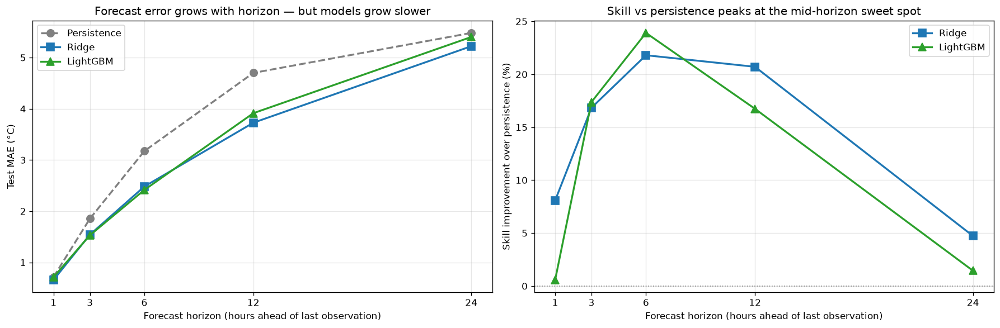

# Horizon-Dependent Forecast Skill — NYC Weather ML

An end-to-end weather forecasting pipeline that demonstrates forecast skill is horizon-dependent: models barely beat persistence at 1-hour lead times, peak in advantage at 6 hours, and lose their edge by 24 hours.



## Headline findings

| Horizon | Persistence | Ridge | LightGBM | Best model | Skill vs persistence |
|---------|-------------|-------|----------|------------|---------------------|
| 1h | 0.717 °C | **0.659** | 0.713 | Ridge | +8% |
| 3h | 1.853 | 1.541 | **1.531** | LightGBM | +17% |
| **6h** | 3.175 | 2.483 | **2.416** | **LightGBM** | **+24%** ← peak |
| 12h | 4.701 | **3.728** | 3.914 | Ridge | +21% |
| 24h | 5.481 | **5.222** | 5.402 | Ridge | +5% |

**Key result:** forecast skill vs persistence is *non-monotonic* — it peaks in the mid-horizon sweet spot where weather systems have evolved but haven't yet forgotten their initial state.

## Model ranking reverses with horizon

- **H=1 (inertia-dominated):** Ridge wins. Linear dynamics of the last hour fully capture the signal.
- **H=3–6 (system evolution):** LightGBM wins. Non-linear features (frontal passages, diurnal warming rates, humidity-temperature interactions) matter.
- **H=12–24 (climatology-dominated):** Ridge wins again. Signal weakens, LightGBM overfits noise, inductive bias of linear models wins.

## Pipeline overview

1. **Cleaning** — sentinel handling, hour snapping to Wunderground's canonical `:51` timestamp, circular interpolation for wind direction, and strict separation between *missing* and *not applicable* NaN values.
2. **EDA** — univariate distributions, bivariate physical invariants, diurnal cycles.
3. **Feature engineering** — 34 leakage-free causal features (lags, rolling stats, cyclical encodings, physics interactions).
4. **Modeling** — persistence baseline, Ridge, LightGBM across 5 horizons.
5. **Error analysis** — stratified residuals by rate of change.

## Data

Source: [Kaggle — New York City Taxi Trip Hourly Weather](https://www.kaggle.com/datasets/meinertsen/new-york-city-taxi-trip-hourly-weather-data)  
Raw file: `Weather.csv` (download separately — not committed to this repo)  
Cleaned file: `data/weather_hourly_clean.csv` (included)

**Data quality note:** Rolling-seasonal anomaly detection identified ~24% of days with temperatures deviating >8 °C from their seasonal neighbors, cross-validated against NOAA Central Park climate normals. This is a source-level issue — the methodological findings in this project are independent of the corrupted rows. See `notebooks/02_eda.ipynb` for the diagnosis.

## Reproducing

```bash
pip install -r requirements.txt
jupyter notebook